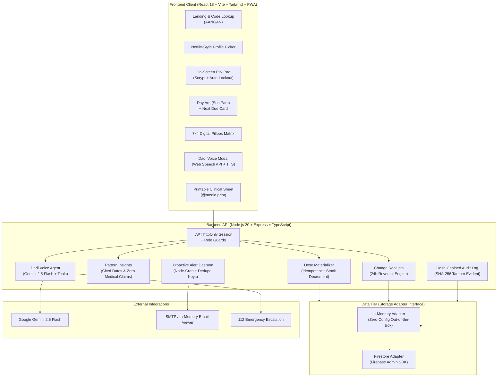

# AANGAN (आँगन) — Elderly Care & Medication Management Platform

> *"Other apps monitor the elder. Aangan makes the elder the head of the household."*

Aangan is a full-stack, elder-centric healthcare ecosystem built for solo hackathons. Rather than treating an elder as a passive patient under surveillance, Aangan gives the elder sovereign control of their "courtyard" (*Aangan*): everyone else—caretakers, adult children, doctors—is an authorized guest whom the elder controls via **Privacy Dials**, **Change Receipts with 24-hour Reversal**, and accessible interfaces (**Netflix-style Profile Picker**, **On-Screen PIN Pad**, **Day Arc Sun-Path**, and **Dadi AI Voice Agent**).

---

## 🌟 Architecture & System Diagram



---

## 🚀 3-Command Setup

Get Aangan running locally in under 60 seconds with **zero external database dependencies**:

```bash
# 1. Clone repository and install monorepo dependencies
npm install

# 2. Build shared models, contracts, and type definitions
npm run build -w shared

# 3. Start both Client (Vite :5173) and Server (Express :4000) concurrently
npm run dev
```

Visit **[http://localhost:5173](http://localhost:5173)** in your browser.

*(To execute automated unit and integration test suites: `npm test`)*

---

## 🔑 Demo Credentials (Sharma Aangan)

The app seeds out-of-the-box with **Sharma Aangan** (Join Code: `AANGAN`):

| Profile | Role | On-Screen PIN | Responsibilities & Access |
| :--- | :--- | :--- | :--- |
| **Dadaji** | `elder` | `1111` | Head of household. Has access to all medicines, 24h reversal of changes, privacy dials, and audit logs. |
| **Priya** | `caretaker` | `2222` | Weekday on-duty caregiver. Has permission to edit medicines and view adherence. |
| **Rahul** | `family` | `3333` | Son. Receives escalated alerts. Elder has restricted check-ins and medicine editing via Privacy Dials. |

---

## 🏆 Signature Innovations

### 1. Netflix-Style Profile Picker + On-Screen PIN Pad
- Elders struggle with small keyboards and typed passwords. Aangan features large circular avatar tiles and an accessible on-screen PIN pad (touch targets ≥ 52px).
- PINs are hashed using cryptographic **scrypt** with random salt.
- Built-in **5-minute auto-lockout** after 5 failed attempts with a live countdown timer.

### 2. Day Arc (Sun-Path SVG) & Elder "Aaj" Screen
- Visual metaphor mapping 4 compartments to the day's sun cycle: **Subah** (08:00), **Dopahar** (13:00), **Shaam** (18:00), and **Raat** (21:30).
- Features a **live sun marker** indicating current time of day.
- **ONE giant card** for the next due compartment with a huge **"Sab Le Li ✓"** button, celebratory confetti micro-animation, and a **10-second Undo Toast** (`aria-live="polite"`).

### 3. "DADI" AI Voice Agent
- Voice-first elderly companion powered by **Gemini 2.5 Flash** and the browser's **Web Speech API** (`hi-IN` / `en-IN` fallback).
- Speech synthesis speaks replies back in gentle, friendly Hinglish.
- **Strict Ethical Guardrails**:
  - Never diagnoses or alters doses (*"Doctor ya pharmacist se pooch lijiye"*).
  - Life-threatening keywords (chest pain, fallen, severe breathlessness) immediately trigger **112 emergency advice** and dispatch priority family alerts.
  - Requires explicit elder confirmation (*"Pakka le li?"*) before marking any medication dose as taken.

### 4. Change Receipts & 24-Hour Reversal
- Any modification made by a caretaker or family member is logged in plain Hinglish (*"Priya ne Pantoprazole ka timing Subah kiya"*).
- Displays as an alert banner on Dadaji's screen.
- Dadaji has a **"Wapas karein (Reverse)"** button valid for 24 hours that safely rolls back the entity to its previous state.

### 5. Granular Privacy Dials (Server-Enforced)
- Dadaji decides who gets to see his adherence, check-ins, and appointments, who can edit medications, and who receives missed alerts.
- Enforced strictly on Express API routes; restricted members see *"Elder ne yeh jaankari private rakhi hai"*.

### 6. Proactive Duty Roster & Email Escalation Daemon
- Runs every minute via `node-cron`, idempotent via `alerts.dedupeKey`.
- Missed doses trigger alerts first to the **On-Duty member** for that slot.
- If unacknowledged within that member's `missedAlertDelayMin`, alerts escalate to backup family members.
- Emails include **two HMAC-SHA256 signed 1-click action links**:
  - *"Maine dekh liya, main sambhal raha hoon"* (Acknowledges & stops escalation).
  - *"Dadaji ne le li hai"* (Marks dose as taken & updates stock).
- Developer/Judge console at `/demo` includes a **Virtual Email Inbox Viewer** (works without requiring real SMTP credentials).

### 7. Clinical Visit Sheet (Doctor Report)
- Generates a 1-page printable clinical summary (`@media print`):
  - 14-day adherence percentage per medication.
  - Missed-dose compartment distribution heatmap.
  - Recent symptoms and mood trends.
  - Prepared questions for the physician.

---

## 🛠️ Tech Stack & Directory Structure

- **Client**: React 18, Vite 6, TypeScript (strict), TailwindCSS, React Router 7, Canvas Confetti, Lucide Icons, PWA (Manifest + Service Worker).
- **Server**: Node.js 20, Express 4, TypeScript, Zod, Node-Cron, Helmet, Express-Rate-Limit, JsonWebToken, Nodemailer, Scrypt, Google GenAI SDK.
- **Database**: Firestore via `firebase-admin`, with automatic fallback to **In-Memory Storage Adapter** when credentials are not configured.
- **Testing**: Vitest test runner.
- **CI**: GitHub Actions workflow.

```
├── client/              # React 18 + Vite PWA frontend
│   ├── src/api/         # Typed REST client
│   ├── src/components/  # DayArc, PinPad, DadiVoiceModal, PrintVisitSheet, etc.
│   ├── src/context/     # Auth, Language, Theme, and OfflineSync contexts
│   └── src/pages/       # Aaj, Pillbox, Medicines, Receipts, Dials, Demo, etc.
├── server/              # Express + TypeScript backend
│   ├── src/auth/        # Scrypt PIN hashing & JWT session management
│   ├── src/services/    # Dadi AI, Alert Engine, Dose Materializer, Seed data
│   ├── src/storage/     # Storage Adapter (In-Memory & Firestore)
│   └── src/tests/       # 12 Vitest unit and integration tests
├── shared/              # Shared types, Zod schemas, constants, and i18n
└── .github/workflows/   # CI build, lint, and test workflow
```

---

## 🔍 Assumptions & Honest Limitations

1. **Speech Recognition Support**: Web Speech API (`webkitSpeechRecognition`) is natively supported in Chromium-based browsers (Chrome, Edge, Brave, Android Chrome). For unsupported browsers, Aangan provides a prominent text-input fallback.
2. **Audio Output (TTS)**: Voice output relies on `window.speechSynthesis`. Voice naturalness depends on the host operating system's installed Hindi or Indian English voice pack.
3. **PWA Service Worker**: The offline cache stores static assets and queues "Le li" taps in `localStorage`. When the device comes back online, `OfflineSyncContext` flushes the queue to the backend.
4. **AI Observational Reasoning**: Gemini 2.5 Flash strictly provides observational summaries correlating missed doses with reported symptoms. It is deliberately forbidden from making medical claims or prescribing dosage alterations.

---

## 📋 Challenge Requirements Mapping

| Line in Challenge Specification | Implemented Feature in Aangan |
| :--- | :--- |
| **Elder at the centre of decisions** | Sovereignty model: Elder owns the Aangan; Change Receipts + 24h reverse; Privacy Dials control family visibility. |
| **Passcode-based access** | Netflix-style Profile Picker + on-screen numeric PIN pad with scrypt hashing and 5-min lockout. |
| **Manage medicines, adherence, appointments** | Full Medicine CRUD, 7×4 Pillbox Matrix, Doctor Visits CRUD with questions collector. |
| **Proactive email reminders** | Node-cron alert daemon with dedupe keys, duty roster escalation, and HMAC signed 1-click action links. |
| **Dadi voice agent** | Voice dialog with Gemini 2.5 Flash, 6 server-executed tools, emergency 112 escalation, and speech synthesis. |
| **Visual identity (Not generic blue)** | Warm Cream, Terracotta, Saffron, Deep Olive, and Sage palette with Fraunces & Atkinson Hyperlegible typography. |
| **Pillbox & Day Arc metaphors** | Interactive 7×4 grid and live SVG sun-path arc with compartment stops. |
